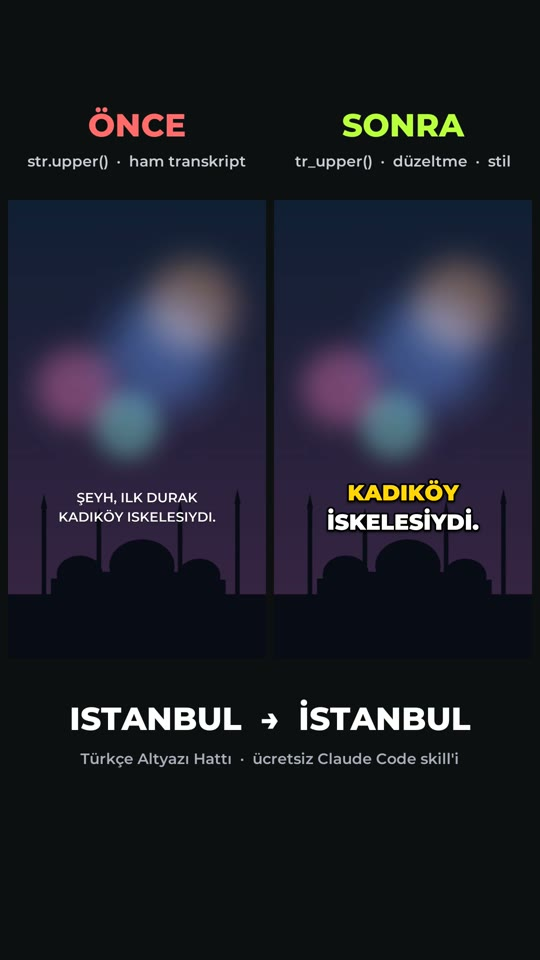
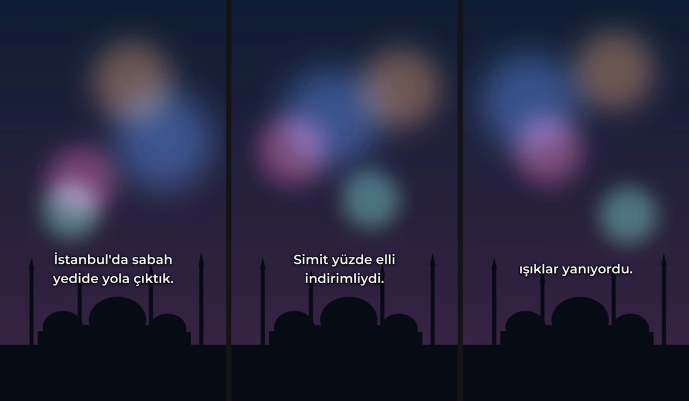
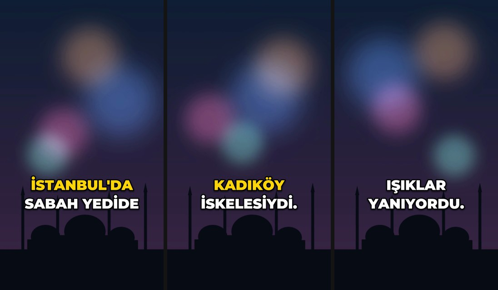
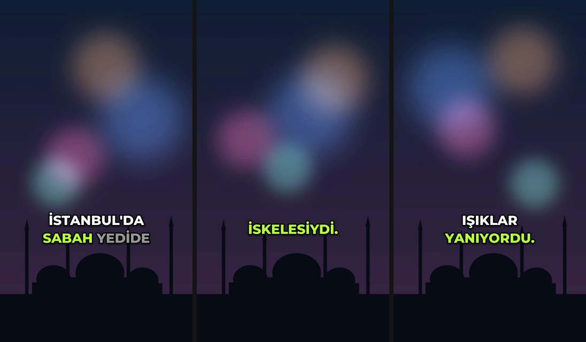

# Türkçe Altyazı Hattı (ücretsiz Claude Code skill'i)

Türkçe konuşmalı video ya da ses → kelime zamanlı altyazı: **SRT + stilli ASS + altyazısı yakılmış MP4**.
Doğru Türkçe büyük harfle: **İSTANBUL**, ISTANBUL değil.

Redirhan Labs tarafından hazırlandı. Ücretsiz, MIT lisanslı. Tamamen yerel çalışır: yayın yok,
hesap yok, ücretli API yok.



## Neden?

Çoğu altyazı aracı ve yapay zekâ ile yazılmış kod, Türkçeyi İngilizce kurallarla büyütüyor:

```python
"istanbul".upper()   # 'ISTANBUL'   (yanlış)
"ilk durak".upper()  # 'ILK DURAK'  (yanlış)
tr_upper("istanbul") # 'İSTANBUL'   (doğru)
```

Aynı sorun JavaScript `toUpperCase()` ve CSS `text-transform: uppercase` (`lang="tr"` yoksa) için de
geçerli. Bu skill büyük harfi, satır bölmeyi ve whisper'ın Türkçedeki sık hatalarını düzeltir.

## Ne yapar

| Adım | Ayrıntı |
|---|---|
| Transkript | Yerel **whisper.cpp** ya da **faster-whisper**, kelime zamanlı. whisper.cpp'nin cümle başlarını sessizliğe koyma hatası, sesteki konuşma bölgelerine göre onarılır. |
| Türkçe büyük harf | `tr_upper`, `tr_lower`, `tr_title` (ve/ile/de/da küçük kalır, TL/YouTube/iPhone korunur) |
| ASR düzeltmeleri | `Istanbul → İstanbul`, `ISKELESIYDI → İSKELESİYDİ`, `Işık/Irak/Isparta` korunur, `İzmir` + `'e` birleşir, `50% → %50`, `herşey → her şey`, `tabi ki → tabii ki`, cümle başındaki `Şeyh → şey` (öneri), "Altyazı M.K." gibi whisper uydurmaları silinir |
| Kırpma önerileri | "ııı, eee" (yüksek güven), ayrık "şey, yani, hani, işte" (orta), kekeleme tekrarları, 0,6 s üstü duraklamalar. `--uygula` ile keser ve altyazı zamanlarını kaydırır |
| Satır bölme | 1-2 satır, güvenli alan içinde (9:16'da sağdaki ikon sütunu ve alttaki açıklama satırı dışında). "ve/ile/bir" satır sonunda kalmaz, "de/da/ki/mi" satır başına düşmez, sayı ile birimi ayrılmaz |
| Çıktı | `.srt` (platformlara yüklemek için), `.ass` (stilli), `.json` (HyperFrames/Remotion için kelime konumlu), `.mp4` (yakılmış), önizleme karesi, rapor |

## 3 ücretsiz stil

| `temiz` | `kalin-vurgu` | `karaoke` |
|---|---|---|
|  |  |  |
| cümle düzeni, 2 satır, yumuşak gölge | büyük harf, 1-3 kelime, sayı ve özel adlar sarı | söylenen kelime yeşil, sıradakiler soluk |

Daha fazla stil içeren bir Pro paketi ileride ayrıca gelebilir. Bu üç stil ücretsiz ve MIT lisanslı kalır.

## Kurulum

```bash
# 1) skill'i Claude Code'a kopyala
mkdir -p ~/.claude/skills
cp -R turkce-altyazi ~/.claude/skills/

# 2) Python ortamı (Pillow + numpy; faster-whisper isteğe bağlı)
python3 -m venv ~/.venvs/turkce-altyazi
~/.venvs/turkce-altyazi/bin/pip install -r ~/.claude/skills/turkce-altyazi/requirements.txt

# 3) ffmpeg
brew install ffmpeg        # macOS  ·  Linux: sudo apt install ffmpeg

# 4) kontrol
~/.venvs/turkce-altyazi/bin/python ~/.claude/skills/turkce-altyazi/scripts/altyazi.py doctor
```

### Transkript motoru (birini kur)

**A) whisper.cpp** (Apple Silicon'da Metal ile hızlı, önerilen):
```bash
brew install whisper-cpp
mkdir -p ~/.cache/whisper-cpp
# ggml-large-v3-turbo-q5_0.bin (~550 MB) dosyasını Hugging Face'teki ggerganov/whisper.cpp
# deposundan indirip ~/.cache/whisper-cpp/ altına koy. Başka yer: TA_WHISPER_CPP_MODEL=/yol/model.bin
```

**B) faster-whisper** (Linux/Windows, NVIDIA GPU varsa CUDA ile):
```bash
~/.venvs/turkce-altyazi/bin/pip install faster-whisper
# model ilk kullanımda indirilir; varsayılan "small". Daha iyisi: --model medium ya da large-v3
```

İkisi de kuruluysa hat önce whisper.cpp'yi (model bulunursa) kullanır; `--asr faster-whisper` ile
değiştirebilirsin. Motor yoksa elindeki SRT ile çalışır: `--srt dosya.srt`.

### Yakma motoru

`ffmpeg -filters | grep -E "ass|subtitles"` çıktısında `ass` varsa altyazı ffmpeg'in **ass filtresiyle**
(libass) yakılır. Yoksa (Homebrew'un güncel ffmpeg'i gibi) **PIL motoru** aynı düzeni çizip karelere
bindirir. Hiçbir yol `drawtext` kullanmaz. `--motor pil` ile PIL'i zorlayabilirsin.

## Kullanım

Claude Code'da: "bu videoya kalın vurgulu altyazı ekle", "şu reels'in SRT'sini çıkar",
"karaoke altyazı yap", "dolguları ve duraklamaları bul". Elle:

```bash
PY=~/.venvs/turkce-altyazi/bin/python
S=~/.claude/skills/turkce-altyazi/scripts
$PY $S/altyazi.py run video.mp4 --stil kalin-vurgu            # -> altyazi_cikti/
$PY $S/altyazi.py run video.mp4 --stil hepsi --vurgu "İstanbul,%50"
$PY $S/altyazi.py trim video.mp4 --kelimeler altyazi_cikti/video.words.json --uygula
$PY $S/altyazi.py demo --cikti altyazi_demo                   # örnek videoyu üret
```

## Örnek

`examples/` klasöründe: kendi ürettiğimiz 11,6 sn'lik Türkçe anlatım (yerel EMA-TTS ile sentezlendi,
gerçek kişi sesi değil) ve PIL ile çizilmiş arka plan üzerinde:
- `demo_once_sonra.mp4`: solda `str.upper()` + ham transkript (ISTANBUL'DA, ILK, ISKELESIYDI, ŞEYH),
  sağda bu hat (İSTANBUL'DA, İLK, İSKELESİYDİ, ŞEY),
- `demo_once.mp4`, `demo_sonra.mp4`, `demo.srt`, üç stilin `.ass` dosyası, düzeltme ve kırpma raporları.

"Önce" tarafı, küçük harfli bir transkriptin (bazı ASR çıktıları ve "küçük harfe çevir" temizliği
yapan araçlar) Türkçe bilmeyen `str.upper()` ile büyütülmesini canlandırır.

## Sınırlar

- whisper Türkçe özel adları ve terimleri yanlış duyabilir; rapordaki öneriler ve kontrol listesi
  bunun içindir, son okumayı insan yapmalı.
- Tamamı büyük harfli yabancı metinde I/İ onarımı ünlü uyumuna dayanır; emin olamadığı sözcüğe
  (`KIZ`, `SIMIT`) dokunmaz.
- ass motoru, libass'lı ffmpeg gerektirir; geliştirme makinemizdeki ffmpeg'de libass olmadığından
  örnekler PIL motoruyla yakıldı.

## Lisans

MIT, Redirhan Labs. Fontlar: Montserrat (SIL OFL 1.1, `scripts/fonts/OFL-Montserrat.txt`).
Demo anlatımı EMA-TTS (Apache-2.0) ile yerelde üretildi. Ayrıntı: `CHANGELOG.md`.
